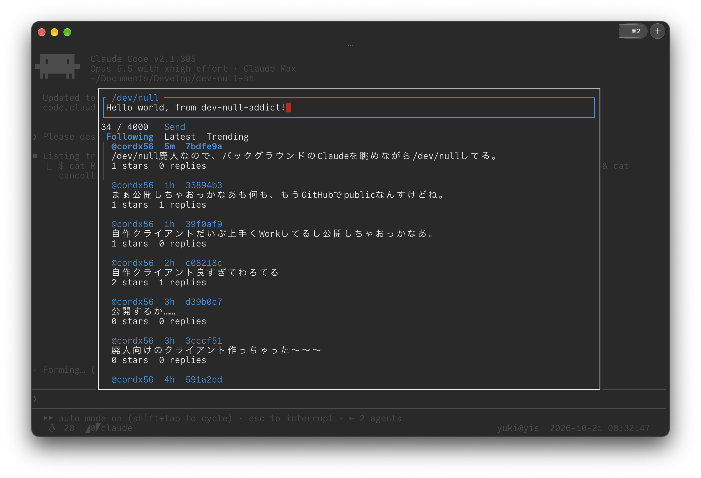

# dev-null-addict

<div align="center">
  <p>
    <a href="https://dev-null.sh">/dev/null</a> over your shell, one key away.
  </p>
  
</div>

dev-null-addict runs your shell on a pseudo-terminal, as tmux does, and passes
everything through. Press the toggle key and /dev/null opens in a window
over the shell: the composer on top, the timeline below, and the shell still
moving faintly behind it. Press the key again, or Esc, and you
are back where you were. The shell keeps running meanwhile, and what it
printed shows up when you close.

It runs on Linux and macOS.

## Install

Just:

```sh
curl -L "https://github.com/cordx56/dev-null-addict/releases/latest/download/dev-null-addict-$(uname -m)-$(uname -s).tar.gz" | tar xz -C "$HOME/.local/bin"
```

or:

```sh
cargo install --path .
```

## Start it with every shell

Put this at the end of `~/.bashrc` or `~/.zshrc`:

```sh
eval "$(dev-null-addict init sh --toggle ctrl+g)"
```

or at the end of `~/.config/fish/config.fish`:

```fish
dev-null-addict init fish --toggle ctrl+g | source
```

`init` prints a small snippet that `exec`s dev-null-addict with the options
given after the shell's name. Run it on its own to see the snippet. If you
would rather not run it at every start, paste its output into the file
instead.

<div align="center">
  <video src="https://github.com/user-attachments/assets/b5926553-6988-4117-8376-b7451d6bf31e" controls></video>
</div>

## Run it on its own

```sh
dev-null-addict
```

Without `--toggle`, dev-null-addict runs no shell and opens /dev/null over
the whole terminal. The keys are the same, and Esc at the top quits. It works
inside a shell that dev-null-addict wraps, too. `--shell`, `--full-screen`
and the shell's arguments need `--toggle`.

## Sign in

dev-null-addict signs its requests with a key of its own, which you approve once
as a device of your account, the way the /dev/null mobile app signs in. The
key is not one of your GitHub keys.

1. Sign in on <https://dev-null.sh> in your browser.
2. Run `dev-null-addict login`. It makes the key, prints a link to the approval
   page and opens it in your browser.
3. Before you approve, open the browser's developer tools on that page and
   select the **Network** tab:
   - Chrome and Edge: Ctrl+Shift+I, or Cmd+Option+I on macOS.
   - Firefox: Ctrl+Shift+E, or Cmd+Option+E on macOS.
   - Safari: turn on Settings, Advanced, *Show features for web developers*,
     then Cmd+Option+I.
4. Click **Approve**. The browser tries to open a `devnull://` link and
   nothing happens, or it asks which app to open it with. Cancel that.
5. In the Network tab, select the `authorize` request with status `303`. Under
   the response headers, copy the value of `Location`. It starts with
   `devnull://`.
6. Paste it into the terminal and press Enter.

/dev/null sends the approval only to `devnull://` addresses, which belong to
the mobile app and which a terminal can't receive, hence the copy and paste.
What you paste is a one-time code. It expires after five minutes, works once,
and only together with this machine's key and a secret that never leaves
this machine. No cookie or password leaves the browser.

The key is at `${XDG_DATA_HOME:-~/.local/share}/dev-null-addict/key`, or where
`--key` says. Revoke the device on the web under Settings, Devices.

## Keys

The toggle key is Ctrl and a letter, given with `--toggle`, such as
`ctrl+g`.

- `ctrl+h`, `ctrl+i` and `ctrl+m` are not accepted. Terminals send them as
  Backspace (on some terminals), Tab and Enter, so those keys would toggle.
- A single press opens /dev/null 300 ms later. Press the key twice within 300
  ms to send it to the shell instead.
- The key is recognised however the terminal sends it: as a control byte, in
  the kitty keyboard protocol, or with xterm's modifyOtherKeys.
- It is ignored inside a bracketed paste. A program that has not turned
  bracketed paste on gets pasted text as typed keys, so a pasted control
  character can still toggle.

Once /dev/null is open:

| Key | |
|---|---|
| toggle key | Close |
| `Esc` | Back: closes a popup, then a thread, then a profile opened with p, then /dev/null, which quits when run on its own |
| `Tab` | Next: composer, Send, timeline |

In the composer, type as usual. Enter starts a new line. Backspace on an empty
draft stops replying or quoting.

Send is next to the character count. Tab stops on it once the draft has 3 to
4000 characters, and Enter on it sends. Focus goes back to the composer
afterwards.

In the timeline and in threads:

| Key | |
|---|---|
| `j` / `k`, `↓` / `↑` | Next / previous commit. A commit taller than the list scrolls line by line first |
| `gg` | Go to the top of the list |
| `h` / `l`, `←` / `→` | Previous / next tab: Following, Latest, Trending, Notifications, Profile (timeline only) |
| `Enter` | Open the thread, with every commit in full |
| `r` | Reply |
| `q` | Quote |
| `s` | Star / unstar |
| `p` | Open the author's profile. On a notification, the profile of who it is from |
| `f` | Follow, on someone else's profile |
| `d` | Delete your commit. It asks first: Enter deletes, Esc keeps it |

The window takes 80% of the terminal's width and height, and the whole
screen when the terminal is too small for that (under 60 by 16 for the
window) or with `--full-screen`. Behind it, the shell keeps running and is
drawn in grey.

When the window is at least 100 columns wide, the keys that work where you
are show down its right edge.

## Timeline

- While /dev/null is open, it refreshes every 5 seconds, or as often as
  `--refresh-interval` says (at least 2). Nothing is fetched while it is
  closed.
- Each commit shows its author, how long ago it was posted, its short hash and
  up to 5 lines of its body. Open the thread to read the rest.
- Under each commit are its stars and replies. The stars count turns yellow
  and gets a `*` once you have starred it.
- Your new commits appear once they are approved. If one is rejected, a
  notification says so.
- Once all replies in a thread are loaded, refreshes append new replies in
  chronological order.
- Errors show up in a popup that goes away by itself.

## Notifications

The Notifications tab, after Trending, lists your notifications as the web
groups them, newest first: follows, replies, quotes, stars, mentions,
rejected commits and level-ups. On one that comes with a commit, `Enter`, `r`,
`q`, `s` and `d` work on that commit as in the timeline.

While /dev/null is open, each refresh checks for unread notifications. When
some arrive, a banner at the bottom shows the newest for 3 seconds. Keys keep
working while it is up. Notifications that arrived while /dev/null was closed
show up on the first refresh after you open it.

Fetching notifications marks them all as read, on the web too, as opening
the web's notifications page does. dev-null-addict remembers which were new:
they are marked `new`, and the tab shows how many you have not looked at yet,
such as `Notifications (2)`, until you have been to the tab.

## Profiles

The Profile tab, after Notifications, shows your own profile. Press `p` on a
commit to see its author's profile there instead, or on a notification to
see the profile of who it is from. Esc goes back to where you pressed `p`.
Moving to another tab with `h` or `l` forgets it, so Profile shows your own
again when you come back.

At the top are the name, the bio, where they are, their counts and when they
joined, and on someone else's profile, whether you follow each other. The
avatar is not shown. Below are the pinned commit and then the other commits,
newest first, which work as in the timeline.

On someone else's profile, `f` follows them. There is no key to unfollow. A
profile you can't see, such as across a block, shows why instead, and is not
fetched again.

## Options

You can get option list by passing `--help` to command arguments.

## Limits

- dev-null-addict sees only the terminal it runs in, not other windows.
- Outside the startup reply window, a lone Esc reaches the shell 10 ms later,
  while dev-null-addict waits to see whether the toggle key follows in an
  escape sequence.
- Startup asks for the cursor position once, waiting up to 100 ms without
  clearing existing output. If the terminal does not answer, startup continues
  immediately with an unsynchronized screen copy. For the next 2 seconds, the
  first complete cursor reply is consumed, even while the overlay is open.
  Its position is used only if no shell output has arrived yet. Partial replies
  are held until complete or until that window ends. Keys with the same encoding,
  such as xterm Shift+F3, can also be consumed once during this window.
- What the shell prints while /dev/null is open is replayed when it closes.
  Past 4 MiB of it, the screen is redrawn instead, and the lines that
  scrolled off are not in the terminal's scrollback. Redraw restores both
  screen buffers and waits up to 50 ms for an incomplete output sequence;
  replay preserves such sequences across closing.
- /dev/null allows 120 signed requests a minute per user, across all your
  terminals, and 10 commits a minute.
